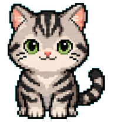

<p align="center">
  
</p>

<h1 align="center">buddy · 安屿雪卡</h1>
<p align="center">运动打卡 · 活力币 · 宠物收集 · AI 陪伴</p>

> 初始伙伴「雪糕」的 idle 第一帧静态图。

## 这是什么

一个**个人自用**的养成小游戏：把现实里的运动打卡变成活力币，再用活力币抽蛋、收集宠物、喂养成长，最后解锁宠物对话。

- 不联网也能玩：打卡、货币、宠物、抽卡、日历、存档全部在本地。
- 唯一联网功能是 AI 对话，使用用户自己填写的 OpenAI 兼容接口。
- 非商业产品，不包含账号、支付、排行榜、社交等模块。

## 核心玩法

```
运动打卡 → 获得活力币 → 抽蛋 / 收集宠物 → 喂养成长 → 解锁对话
                ↑                         ↓
             全勤宝箱 ←──── 日历补卡 / 取消 ────┘
```

- **打卡**：周一 / 三 / 五 / 六为训练日，其余为休息日；每天只能打卡一次。
- **活力币**：训练日给币更多，休息日 +1；连续训练有额外加成；全勤宝箱额外 +20。
- **补卡 / 取消**：日历支持单日与批量操作；补卡免费、全额给币、算连续，取消会扣回对应活力币。
- **抽卡**：粮食 79% / 书籍 18% / 蛋 3%；30 抽内必出蛋；蛋必出新宠物，集齐后转化为粮食。
- **养成**：任意宠物都可以喂养；成长值满 50 + 4 本书解锁 AI 对话。
- **对话**：宠物角色卡 + 最近 20 条上下文，整段回复，不做流式逐字。

## 页面

### Tab 页

| 页面 | 作用 |
|------|------|
| 首页 | 今日打卡、陪伴宠物、全勤旗子小路、抽奖入口 |
| 宠物 | 已获得宠物网格、切换陪伴、进入详情 |
| 聊天 | 已解锁对话的宠物会话列表 |
| 日历 | 月历打卡历史、单日/批量补卡与取消、月度统计 |
| 我的 | 概览、背包、货币流水、数据导入导出/备份、AI 设置 |

### 独立页 / 弹层

- 抽奖页：单抽 / 十连、保底进度、破壳演出、结果与新宠物揭晓。
- 宠物详情页：动作预览、成长进度、喂养、解锁对话、设为陪伴、开始聊天。
- 聊天页：消息流、发送、失败重试、选择中宠物等待动画。
- 货币流水页：按时间倒序的每一笔收入 / 支出与余额。
- 弹层：打卡反馈、全勤宝箱、破壳、对话解锁、产币提示、补卡 / 取消确认。

## 技术栈

- **uni-app x + Vue 3 + UTS**
- 当前主要运行于 **Android**，也可编译 **H5**
- 本地 **SQLite** 持久化
- 宠物动画使用 **webp 图集 + 帧切换**，不使用 canvas / 粒子 / 缓动特效
- 无后端、无账号体系

### 代码结构

```
03-开发/buddy
├── pages/                  # 页面：首页、宠物、聊天、日历、我的、抽奖、详情、流水
├── components/
│   ├── pet-sprite/         # 宠物图集裁切与帧播放
│   └── game-icon/          # 游戏图标
├── common/
│   ├── repository.uts      # SQLite 读写、抽卡、打卡、导入导出、备份
│   ├── store.uts           # 页面只读快照
│   ├── game.uts            # 打卡 / 全勤 / 日历纯逻辑
│   ├── date.uts            # 日期、周计划、给币规则
│   ├── ai.uts              # OpenAI 兼容接口
│   ├── pet-catalog.uts     # 宠物图鉴索引
│   ├── pet-anim.uts        # 图集行序、帧数、动作映射
│   └── types.uts           # 数据模型
├── static/
│   ├── pets/               # 每只宠物：pet.json / persona.md / spritesheet.webp
│   ├── tabbar/             # TabBar 图标
│   └── *.png               # 粮食、书籍、蛋、币等图标
├── App.uvue                # 全局主题变量与基础样式
├── pages.json              # 页面、导航栏、TabBar 配置
├── uni.scss                # 色板、纸张肌理变量
├── manifest.json           # 应用配置
└── AGENTS.md               # 代码与视觉执行规则
```

## 运行

本项目使用 **HBuilderX（uni-app x）**，没有 npm / Vite 启动脚本。

1. 用 HBuilderX 打开 `03-开发/buddy`。
2. 运行到 Android 真机 / 模拟器，或运行到 H5。
3. 首次进入首页点击「领取初始宠物」。
4. 在「我的 → 设置 → AI 接口」填写 API Key / Base / 模型后，聊天功能可用。

> H5 端调用 AI 接口需要接口支持 CORS，否则请在 Base 中填写可用代理地址。

## 数据与隐私

- 所有游戏数据保存在本机 SQLite。
- API Key 只保存在本机 `settings` 表，导出存档时会排除。
- 支持 JSON 导出 / 导入、手动备份，默认保留最近 7 份备份。
- 删除应用数据前请先导出或备份。
- 如果 Key 曾出现在源码或构建产物里，建议到 AI 平台重置。

## 宠物素材

- 图鉴位于 `static/pets/`，当前共 22 只。
- 标准图集：8 列 × 9 行，单帧 192×208px。
- 行序：idle / running-right / running-left / waving / jumping / failed / waiting / running / review。
- v2 素材中的 16 向注视行首版不使用。
- 静态预览图：`static/pets/xuegao/idle.png`（雪糕 idle 第一帧）。

## 视觉风格

当前为 **B 版「手绘场景」**：

- 暖米色纸底、墨色描边、平涂色块；无渐变、无毛玻璃、无弥散阴影。
- 卡片默认实线描边；虚线只用于票根、印章、路径、空态。
- 展示级文字使用系统衬线（`.buddy-display`），正文系统无衬线。
- 允许少量静态手绘装饰：地平线、草、胶带、印章、手写批注、抽奖台。
- 宠物是场景主角，不套贴纸框；首页不使用太阳 / 山脉背景。
- 所有 `scroll-view` 绑定 `:show-scrollbar="false"`，页面可滚动但不显示滚动条。
- 页面根容器固定视口高度并 `overflow: hidden`，只允许内部滚动容器滚动。

设计样张：本地工作区 `02-设计/demo-首页风格-v3.html`（设计文档未纳入本仓库）。
代码层规则见 [`AGENTS.md`](./AGENTS.md)。

## 当前状态

- 功能链路已完整：打卡、货币、抽卡、宠物、日历、AI 对话、存档。
- 视觉已统一到 B 版：首页、详情、宠物窝、聊天、日历、抽奖、我的、流水。
- 宠物素材风格不完全统一（像素猫、二次元角色等），后续按统一插画风格替换。
- 仅个人使用，未授权商用。
